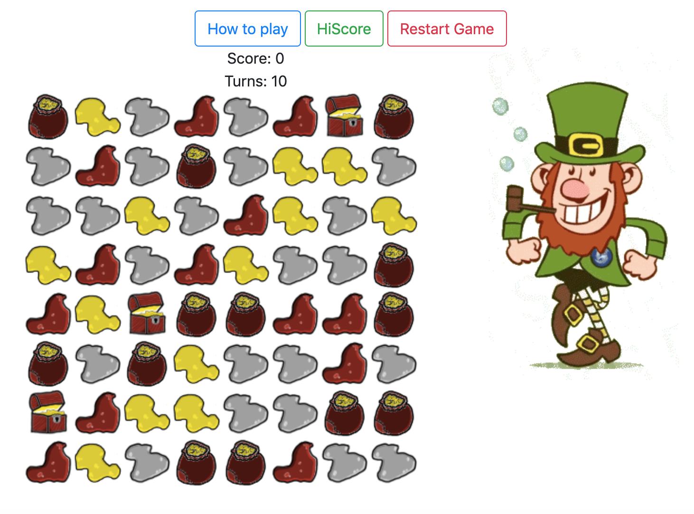

# Leprechaun


Leprechaun is a game based on [Gems of War](https://gemsofwar.com/), the [Threasure Hunt](https://gemsofwar.zendesk.com/hc/en-us/articles/205368765-Treasure-Hunt-and-Treasure-Maps).

The base of the game is swap pieces, only one each time and only with the ones in north, south, east or west of the source one. The combinations should be made by 3 or more in vertical or horizontal way. If you achieve to match 4 then you won't loose a turn and if you achieve match more than 4 then you'll obtain an extra turn. The game starts with 10 turns and ends when you run out of turns.

If you love this content and want we can generate more, you can support us:

[](https://www.paypal.com/cgi-bin/webscr?cmd=_s-xclick&hosted_button_id=RC5F8STDA6AXE)

## Checking code

The source code has implemented different tools to ensure we are arriving to a minimal internal quality, that's because we are working to get the output of this command green:

```
mix check
```

The gate runs the full test suite with coverage and requires at least 90% overall
coverage. Run `mix test --cover` to inspect the per-module results and the HTML
reports under `cover/`.

## Installation

It's easy to install. You only need to have [Elixir](https://elixir-lang.org/install.html) 1.18 or newer installed and run this to obtain the code:

```
git clone git@github.com:altenwald/leprechaun.git
```

Because we use [Ecto](https://hexdocs.pm/ecto/Ecto.html) and [SQLite](https://www.sqlite.org/) to store the high scores you'll need to run these tasks before:

```
mix do ecto.create, ecto.migrate
```

Then you can see there are a new directory in that path called `leprechaun`. You can go inside using the terminal and write:

```
iex -S mix run
```

The Elixir shell will be running after the compilation. You can start the game using this command:

```elixir
Leprechaun.Console.run :mygame
```

Follow the instructions and enjoy!

### Web Interface

The web interface uses [Bandit][1] with Plug for HTTP and static files,
WebSock/WebSockAdapter for `/websession`, and [Jason][2] for JSON messages.

Version 1.0 has been a rewrite of the website using [Phaser3][3] 

[](screenshot_web.png)

You only need to run the project as showed above (in the previous section) and then access via this link:

http://localhost:4012

You can change the configuration to listen in another port and even to use IPv6 instead.

The PHP bot editor and code execution interface have been removed. The `/bot/`
page is no longer available; the browser game remains at `/`.

Enjoy!

### Production release

Build with the native Elixir release task on the same OS and architecture as the
deployment server:

```sh
MIX_ENV=prod mix release
```

This fetches production dependencies, compiles the application and generates
`_build/prod/rel/leprechaun/` and `_build/prod/leprechaun-1.2.4.tar.gz`.
Extract the archive into a new release directory on the server.

Set the runtime environment before starting the release (also set it for `rpc`,
`remote` and `stop`):

```sh
export PORT=4012
export DATABASE_PATH=/var/lib/leprechaun/leprechaun.db
export RELEASE_NODE=leprechaun@127.0.0.1
# Set RELEASE_COOKIE from the service's environment or secret configuration.
bin/leprechaun start
```

`DATABASE_PATH` is required in production and is read when the release starts.
The service user must have write access to its parent directory, including for
SQLite's WAL and shared-memory files. Keep the database outside the release
folder so it survives upgrades. Development and tests use separate files under
`data/` unless `DATABASE_PATH` is set. Migrations run automatically before the
HTTP server starts.

The first migration imports the 559 production high scores captured on
2026-10-28 from `leprechaun.altenwald.com`. The snapshot is stored in
`priv/repo/seeds/production_scores.json`; it preserves IDs, names, scores, turns,
extra turns and original timestamps, without IP addresses. Scores added on the
old production server after this snapshot are not included.

The import is transactional and tracked in `schema_migrations`, so restarts and
repeated `mix run priv/repo/seeds.exs` calls do not duplicate or restore rows.
It refuses to import into a nonempty table to avoid overwriting existing scores.
The original Mnesia files are not modified. Back up SQLite using its backup API,
or stop the service before copying the database and any journal files.

For systemd, use `Type=simple` and `ExecStart=/path/to/current/bin/leprechaun start`,
with the variables above in its environment file. Native `start` runs in the
foreground; replace any old `start`/`stop` forking arrangement accordingly.
Keep `RELEASE_COOKIE` stable between deployments for remote commands; otherwise
Mix generates a cookie when assembling the release.

Useful release commands (migrations can also run while the service is stopped):

```sh
bin/leprechaun remote
bin/leprechaun eval 'Leprechaun.ReleaseTasks.run_migrations()'
bin/leprechaun stop
```

The migration task replaces the old `remote_migrate` command. Deploy upgrades by
stopping the service, switching to the new release directory and starting it
again. See the [native release documentation](https://hexdocs.pm/mix/1.13/Mix.Tasks.Release.html)
for available commands and platform requirements.

### Dymploy

`dymploy.yaml` follows Zero's deployment layout and Backlog `servers #130`, with
`rowan-leprechaun` as the target. The build runs `mix check --no-retry` (including the 90% coverage gate),
assembles the native release, and runs its migrations twice against a temporary
SQLite database to verify the packaged driver and initial score import.

Validate and build locally without delivering anything to a server:

```sh
dymploy validate .
dymploy try .
```

Do not add `--deploy` to the local build command until deployment is intended.
The artifact contains the release directory; it contains no runtime database.

Infrastructure is managed in `~/Projects/Altenwald/servers`; the migration
procedure and status belong to Backlog `servers #130`. The local inventory
entries prepare the following, which must be provisioned before deployment:

- A `rowan-leprechaun` dymploy target for `github/altenwald/leprechaun`, branch
  `master`, connecting to Rowan as `deploy-leprechaun`.
- The `leprechaun` service user and group, deployment user, and the existing
  systemd service/path mechanism watching `/home/deploy-leprechaun/.deployed`.
  The service must source `/home/deploy-leprechaun/leprechaun.env` and run
  `/home/deploy-leprechaun/current/bin/leprechaun start` in the foreground.
- A writable `/var/lib/leprechaun` directory and `tmp` subdirectory owned by
  `leprechaun`, with SQLite backups configured for
  `/var/lib/leprechaun/leprechaun.db`.
- Proxy and firewall configuration for `leprechaun.altenwald.com` to Rowan's
  port 4012, and repository access/webhook configuration for dymploy. Coordinate
  the switch from Oak and disable the legacy deployment pipeline before enabling
  the new one.

Production artifacts must be built by dymploy on Alder, using this Debian 13
image and the server's architecture. `dymploy try` on a development machine is
only a local validation; its artifact must not be deployed to production.

The manifest installs releases under `$HOME/releases/$DYMPLOY_SHORT_COMMIT`,
writes the runtime environment, switches `current`, and triggers a restart.
It checks HTTP on port 4012 before pruning old releases, retaining the latest
three and the active release. An existing release directory is never overwritten.
There is no automatic rollback; a failed health check preserves the releases for
inspection and recovery.

SQLite remains outside the release directories. The first startup imports the
snapshot described above; refresh that snapshot before the production cutover if
new scores have been recorded on Oak. Dymploy sets `RELEASE_DISTRIBUTION=none`,
so distributed `remote`, `rpc` and `stop` commands are unavailable in this setup;
use systemd to manage the service and `eval` for offline release tasks.

`TRUSTED_PROXIES` is a comma-separated list of proxy IP addresses allowed to
supply `X-Forwarded-For`. Dymploy sets it to Maple's private address; other peers
cannot override their client address with that header. Without this variable,
only loopback proxies are trusted.

[1]: https://github.com/mtrudel/bandit
[2]: https://github.com/michalmuskala/jason
[3]: https://phaser.io/
